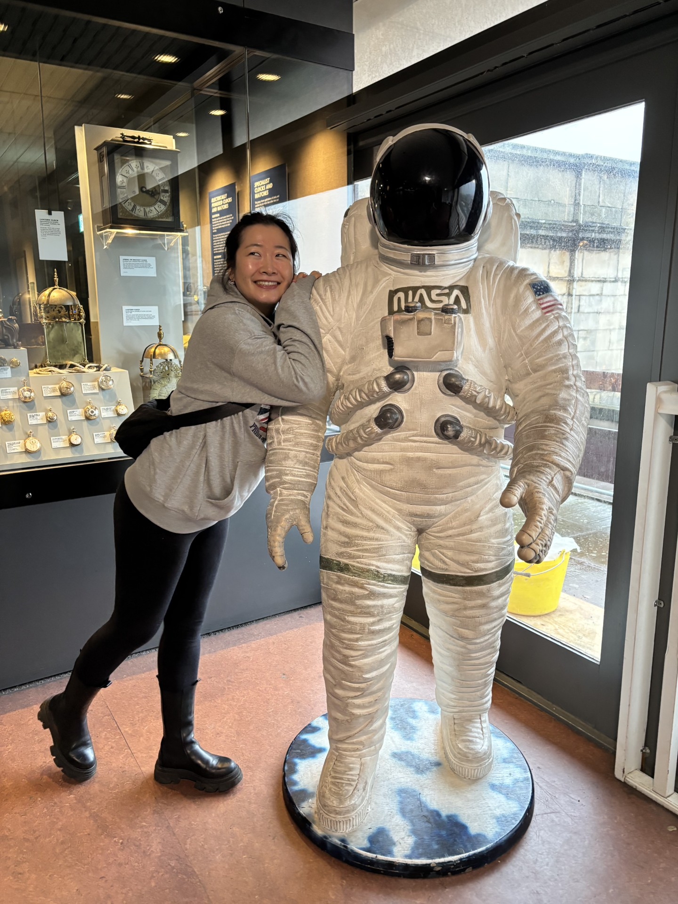

<!-- A. Edit the name, heading and introduction here. -->
::: {.home-hero}
::: {.intro-copy}
[Jane Zhang]{.eyebrow}

# Curiosity, evidence, and imagination. {.unlisted .unnumbered}

I'm Jane Zhang, with a background in business and data science, and a passion for creative writing. I'm interested not only in what technology makes possible, but also in its implications for business, society, and people's lives.

Curiosity leads me to questions, and imagination helps me explore possibilities. Whether analysing data, investigating complex systems, or writing fiction, I enjoy challenging assumptions and exploring new perspectives. In analytical work, I believe ideas should be tested against evidence, while recognising uncertainty and remaining open to revising conclusions.

[A little more about me →](about.qmd){.text-link}
:::

<!-- Original uploaded photograph; the responsive crop is set in styles.css. -->
```{=html}
<figure class="hero-portrait">
  <div class="portrait-frame">
    
  </div>
</figure>
```
:::

<!-- B. Working introduction: refine the wording together. -->
::: {.home-section .purpose-section #purpose}
::: {.purpose-heading}
## Why this website exists
:::

::: {.purpose-copy}
I created this space not only to share my work, but also to invite others to explore questions alongside me.

Through data projects, creative writing, and independent research, I share ideas, methods, discoveries, and reflections, including the assumptions I question and what remains uncertain. Rather than offering definitive answers to every complex issue, I hope to encourage thoughtful exploration, meaningful discussion, and independent judgment.
:::
:::

<!-- C. Each link leads to a dedicated, editable section page. -->
::: {.home-section #explore}
## Explore my work

Three ways I explore questions—through data, storytelling, and the systems shaping our world.

::: {.work-areas}
::: {.work-area}
### 01 — Data Projects {#data-projects}

Explore how I approach analytical questions, from choosing methods and interpreting results to examining limitations and what I would improve.

[Explore data projects →](data-projects.qmd){.text-link}
:::

::: {.work-area}
### 02 — Writing {#writing}

Published fiction, completed manuscripts, and creative explorations of human experience in an increasingly technology-shaped world.

[Explore my writing →](writing.qmd){.text-link}
:::

::: {.work-area}
### 03 — AI & Energy {#ai-energy}

Explore how AI and energy systems affect each other, and what this means for society. Evidence-based explanations, emerging challenges, and developments across the US, EU, and China.

[Explore AI & Energy →](ai-energy.qmd){.text-link}
:::
:::
:::

<!-- D. Only feature real work; add details and original sources when available. -->
::: {.home-section #selected-work}
## Selected Work

A selection of completed work and ongoing investigations.

::: {.selected-list}
::: {.selected-item}
[MSc Research]{.work-type}

::: {}
### Physics-Informed Machine Learning in Space Plasma Physics

My master's dissertation investigates the application of machine learning and physics-informed approaches to space plasma data from the Solar Orbiter mission.
:::

[*View research project →*](projects/msc-space-plasma.qmd){.text-link}
:::

::: {.selected-item}
[Published Fiction]{.work-type}

::: {}
### Juan's World

A science-fiction novel exploring imagined futures, technological change, and the choices people make within them.
:::

[*Discover the book →*](writing.qmd#published-work){.text-link}
:::

::: {.selected-item}
[Independent Research · Ongoing]{.work-type}

::: {}
### AI & Energy: Beyond the Headlines {#ai-energy-and-everyday-life}

An independent investigation into the relationship between AI infrastructure, electricity systems, and society, examining developments, challenges, and regulatory responses across the US, EU, and China.
:::

[*Explore the research →*](ai-energy.qmd){.text-link}
:::
:::
:::

<!-- E. Existing public profiles provide contact; no invented address or form. -->
::: {.home-section .contact-section #connect}
::: {.contact-copy}
[Contact & collaboration]{.eyebrow}

## Let's connect

I'm always interested in exchanging ideas, exploring new perspectives, and connecting with people who share an interest in data science, technology, and creative writing.

Whether you have a question, an idea, or a potential collaboration in mind, I'd be happy to hear from you.
:::

::: {.contact-links}
[Connect on LinkedIn](https://www.linkedin.com/in/janezhang-techlearner/){.text-link}

[Explore my GitHub](https://github.com/Jane-bunny){.text-link}
:::
:::
